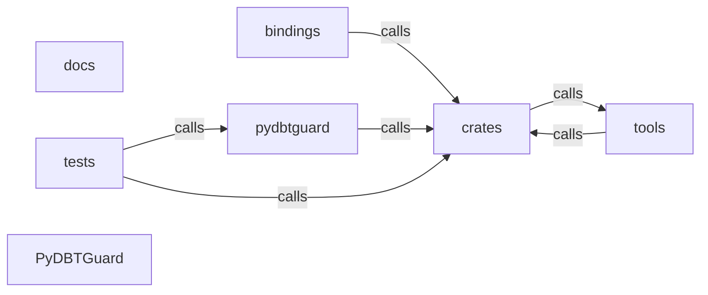

_Generated by CodeAtlas._

## Details

Architecture map of PyDBTGuard.

### bindings

Owns 0 symbols across 0 file(s).

**Related Classes/Methods:** _None_

### crates

Owns 0 symbols across 0 file(s).

**Related Classes/Methods:** _None_

### docs

Owns 0 symbols across 1 file(s).

**Related Classes/Methods:** _None_

### pydbtguard

Owns 28 symbols across 3 file(s).

**Related Classes/Methods:** _None_

**Source Files:**

- `pydbtguard/artifacts.py`
  - `pydbtguard.artifacts.ArtifactError`
  - `pydbtguard.artifacts.RunHistoryStore`
  - `pydbtguard.artifacts.RunHistoryStore.__init__`
  - `pydbtguard.artifacts.RunHistoryStore._is_duplicate`
  - `pydbtguard.artifacts.RunHistoryStore._snapshots`
  - `pydbtguard.artifacts.RunHistoryStore.history_text`
  - `pydbtguard.artifacts.RunHistoryStore.record_from_run_results`
  - `pydbtguard.artifacts.RunHistoryStore.recorded_run_count`
  - `pydbtguard.artifacts._read_required`
  - `pydbtguard.artifacts.catalog_text`
  - `pydbtguard.artifacts.manifest_text`
  - `pydbtguard.artifacts.run_results_text`
  - `pydbtguard.artifacts.sources_text`
  - `pydbtguard.artifacts.target_dir`
- `pydbtguard/cli.py`
  - `pydbtguard.cli._GuardGroup`
  - `pydbtguard.cli._GuardGroup.invoke`
  - `pydbtguard.cli._call`
  - `pydbtguard.cli._dump`
  - `pydbtguard.cli._project`
  - `pydbtguard.cli.analyze`
  - `pydbtguard.cli.blast_radius`
  - `pydbtguard.cli.cli`
  - `pydbtguard.cli.cost`
  - `pydbtguard.cli.coverage`
  - `pydbtguard.cli.drift`
  - `pydbtguard.cli.freshness`
  - `pydbtguard.cli.history`
  - `pydbtguard.cli.main`

### tests

Owns 28 symbols across 4 file(s).

**Related Classes/Methods:** _None_

**Source Files:**

- `tests/conftest.py`
  - `tests.conftest.fixtures_dir`
  - `tests.conftest.project`
  - `tests.conftest.project_with_history`
- `tests/test_artifacts.py`
  - `tests.test_artifacts.payload_to_text`
  - `tests.test_artifacts.test_catalog_is_optional`
  - `tests.test_artifacts.test_history_store_ignores_non_test_and_skipped`
  - `tests.test_artifacts.test_history_store_records_real_outcomes`
  - `tests.test_artifacts.test_manifest_missing_raises_with_actionable_hint`
  - `tests.test_artifacts.test_sources_text_reads_explicit_path`
- `tests/test_cli.py`
  - `tests.test_cli.run`
  - `tests.test_cli.test_analyze_json_is_typed_and_real`
  - `tests.test_cli.test_analyze_missing_manifest_exits_cleanly`
  - `tests.test_cli.test_analyze_records_history_then_reports_it`
  - `tests.test_cli.test_blast_radius_reports_real_impact`
  - `tests.test_cli.test_blast_radius_unknown_model_is_an_error`
  - `tests.test_cli.test_cost_requires_and_uses_catalog`
  - `tests.test_cli.test_cost_without_catalog_is_a_clear_error`
  - `tests.test_cli.test_coverage_lists_prioritized_gaps`
  - `tests.test_cli.test_drift_compares_two_catalogs`
  - `tests.test_cli.test_freshness_reshapes_sources_json`
  - `tests.test_cli.test_history_uses_recorded_outcomes`
  - `tests.test_cli.test_history_without_recordings_is_a_clear_error`
  - `tests.test_cli.test_version_reports_engine_version`
- `tests/test_codeatlas_adapter.py`
  - `tests.test_codeatlas_adapter._run`
  - `tests.test_codeatlas_adapter.test_check_reports_the_embedded_engine_available`
  - `tests.test_codeatlas_adapter.test_diagnose_summarises_the_architecture_map`
  - `tests.test_codeatlas_adapter.test_explain_reports_an_unknown_node_as_an_error`
  - `tests.test_codeatlas_adapter.test_god_nodes_are_ranked_by_degree`

### tools

Owns 0 symbols across 0 file(s).

**Related Classes/Methods:** _None_

### PyDBTGuard

Owns 0 symbols across 12 file(s).

**Related Classes/Methods:** _None_
