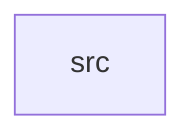

_Generated by CodeAtlas._

## Details

Owns 0 symbols across 1 file(s).

### src

Owns 10 symbols across 1 file(s).

**Related Classes/Methods:** _None_

**Source Files:**

- `bindings/python/src/lib.rs`
  - `bindings.python.src.lib._core`
  - `bindings.python.src.lib.analyze`
  - `bindings.python.src.lib.blast_radius`
  - `bindings.python.src.lib.cost`
  - `bindings.python.src.lib.coverage`
  - `bindings.python.src.lib.drift`
  - `bindings.python.src.lib.engine_version`
  - `bindings.python.src.lib.freshness`
  - `bindings.python.src.lib.history`
  - `bindings.python.src.lib.wrap`
